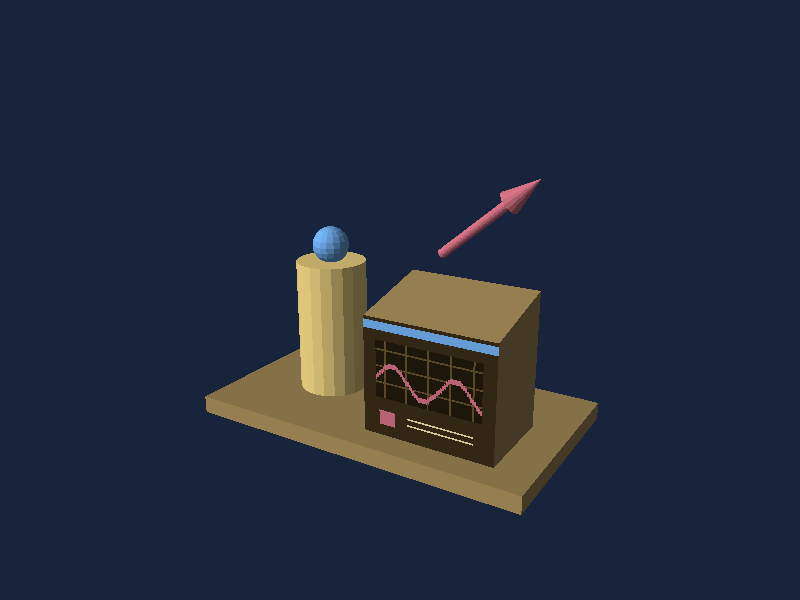
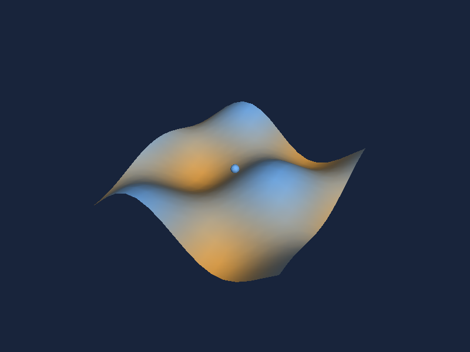

# Five examples to learn from

Create the two-shape scene in [Getting started](getting-started.md) first, then follow these five examples in order. Each adds a different API concept, progressing from primitives to a mechanism with coordinated moving parts. Each file creates a scene, fits its camera and supplies a time-based animation. The gallery adds orbit, zoom and selection through the same `SceneView` you use in an app. The texture, lighting, normals, vertex-color and OBJ examples require `0.2.0-preview.1` or later.

| Example and source | What to learn | Motion |
| --- | --- | --- |
| [Equipment](https://github.com/mariusmuntean/Simple3D-Maui/blob/main/samples/Simple3D.Shared/Equipment.cs) | Named primitives and groups; an OBJ controller with UV-mapped display | Output vector sweeps |
| [Telemetry](https://github.com/mariusmuntean/Simple3D-Maui/blob/main/samples/Simple3D.Shared/Telemetry.cs) | Orthographic camera and data-driven height and color | Bars change within a fixed scale |
| [Surface](https://github.com/mariusmuntean/Simple3D-Maui/blob/main/samples/Simple3D.Shared/Surface.cs) | Height-based vertex colors, flat/smooth normals and directional light controls | Sample marker follows a wave |
| [Robot Arm](https://github.com/mariusmuntean/Simple3D-Maui/blob/main/samples/Simple3D.Shared/RobotArm.cs) | Nested transforms and selectable joints | Shoulder and elbow articulate |
| [Gantry Crane](https://github.com/mariusmuntean/Simple3D-Maui/blob/main/samples/Simple3D.Shared/GantryCrane.cs) | Linked motion with fixed structure and reusable geometry | Carriage traverses while the hoist lifts its load |






In **Equipment**, orbit the controller beside the motor: the chart belongs to a mapped front face, while the solid sides reveal the imported enclosure's depth. `ObjReader.Parse` imports the wedge and its independent UV indices once. A small opaque `Texture2D` supplies its display and body colors. The texture is generated in the shared sample so Core-only image exports need no codec; use [TextureLoader.Load](materials-and-import.md#textures) in a MAUI app to decode an image once before creating the material.

In **Surface**, choose **Shading: smooth / flat**, then **Light: from right / left**. Smooth mode uses averaged vertex normals; flat mode omits normals from the same wave geometry. Both keep the height gradient and 512 triangles, so the comparison isolates lighting rather than changing mesh detail. The light-ray direction changes in world space while the orbit camera stays put. [SurfaceComparison.cs](https://github.com/mariusmuntean/Simple3D-Maui/blob/main/samples/Simple3D.Shared/SurfaceComparison.cs) keeps both meshes and lights prepared; switching does no geometry generation and preserves selection. **Reset** restores smooth shading, light from the right, the initial camera and sample-marker position. The comparison controls appear only in Surface, in the horizontally scrollable tool row.

Telemetry and Gantry Crane use synthetic values, not live sensors or physical simulations. In an application, replace the time functions with measured values. Reuse immutable meshes and keep child order stable so selection follows the same logical part after replacement. The small shared helpers live in [DemoScenes.cs](https://github.com/mariusmuntean/Simple3D-Maui/blob/main/samples/Simple3D.Shared/DemoScenes.cs).

Robot Arm demonstrates child transforms relative to a parent. Gantry Crane combines group translation with state-dependent part dimensions: the cable changes length as the load rises. They teach different uses of the same hierarchy API. The examples share their animation and color helpers rather than repeating them in each file.

The [gallery page](https://github.com/mariusmuntean/Simple3D-Maui/blob/main/samples/Simple3D.Demo/GalleryPage.cs) owns the UI timer, lowers render resolution during animation and pauses on backgrounding. It targets 60 updates per second; this is not a displayed-frame-rate guarantee. Press Animate after returning to the app.

## Mirror

The gallery's **Mirror ✦** button opens a full-screen scene in which a frog copies the person the camera sees. It asks for the camera, shows a silhouette until someone is in frame (whole body, or from the waist up), then reveals the character on its pond and keeps the camera as a small inset. Legs out of frame keep the frog standing; turning around shows the frog's back. Pinch to zoom the camera and use ⇄ to switch between the front and back camera. When the person leaves the frame, the frog holds its pose and a hint asks them to step back in; haptics mark both moments. Video stays on the device.

| Piece | Source |
| --- | --- |
| Tracking states and smoothing | [PoseTracker.cs](https://github.com/mariusmuntean/Simple3D-Maui/blob/main/samples/Simple3D.Shared/Mirror/PoseTracker.cs) |
| Landmarks → humanoid bone rotations | [HumanoidRetargeter.cs](https://github.com/mariusmuntean/Simple3D-Maui/blob/main/samples/Simple3D.Shared/Mirror/HumanoidRetargeter.cs) |
| Pond scene from primitives | [MirrorStage.cs](https://github.com/mariusmuntean/Simple3D-Maui/blob/main/samples/Simple3D.Shared/Mirror/MirrorStage.cs) |
| Camera, detectors and page | [Simple3D.Demo/Mirror](https://github.com/mariusmuntean/Simple3D-Maui/tree/main/samples/Simple3D.Demo/Mirror) |

Detection runs on the device: Apple Vision is built into iOS and macOS; on Android, the ML Kit accurate pose model arrives with its NuGet package (a few megabytes in the APK). Detectors report 2D landmarks: the retargeter turns each limb toward its landmark direction and estimates depth from foreshortening, so motion toward the camera is approximate. The character is [100Avatars "Froggy"](https://github.com/PolygonalMind/100Avatars) by Polygonal Mind (CC0), loaded with `GltfLoader`; see [skinned characters](skinned-characters.md).

## Render without MAUI

```bash
dotnet run --project tests/Simple3D.Core.Tests -c Release -- --render-images Equipment equipment.ppm
dotnet run --project tests/Simple3D.Core.Tests -c Release -- --render-images --all output
```

This exports initial still frames as binary PPM and skips the test run. Convert them to PNG with `python3 scripts/render-doc-images.py` to regenerate the documentation images. Rendering supports opaque textured triangles and flat or smooth directional lighting; see [limits](rendering-limits.md) before choosing a workload.
