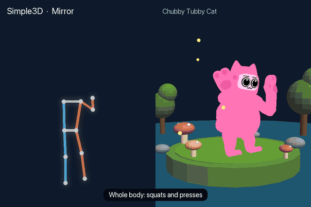
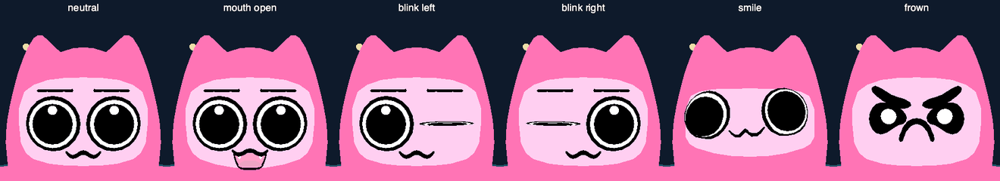
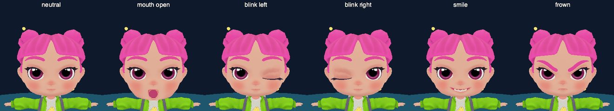
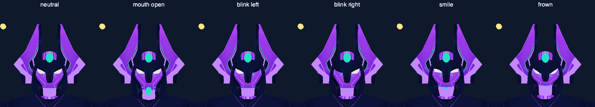
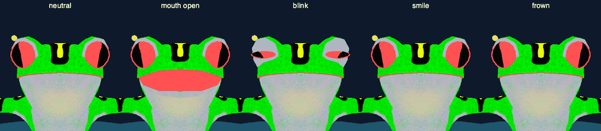

# Five examples to learn from

Create the two-shape scene in [Getting started](getting-started.md) first, then follow these five examples in order. Each adds a different API concept, progressing from primitives to a mechanism with coordinated moving parts. Each file creates a scene, fits its camera and supplies a time-based animation. The gallery adds orbit, zoom and selection through the same `SceneView` you use in an app. The texture, lighting, normals, vertex-color and OBJ examples require `0.2.0-preview.1` or later.

| Example and source | What to learn | Motion |
| --- | --- | --- |
| [Equipment](https://github.com/mariusmuntean/Simple3D-Maui/blob/main/samples/Simple3D.Shared/Equipment.cs) | Named primitives and groups; an OBJ controller with UV-mapped display | Output vector sweeps |
| [Telemetry](https://github.com/mariusmuntean/Simple3D-Maui/blob/main/samples/Simple3D.Shared/Telemetry.cs) | Orthographic camera and data-driven height and color | Bars change within a fixed scale |
| [Surface](https://github.com/mariusmuntean/Simple3D-Maui/blob/main/samples/Simple3D.Shared/Surface.cs) | Height-based vertex colors, flat/smooth normals and directional light controls | Sample marker follows a wave |
| [Robot Arm](https://github.com/mariusmuntean/Simple3D-Maui/blob/main/samples/Simple3D.Shared/RobotArm.cs) | Nested transforms and selectable joints | Shoulder and elbow articulate |
| [Gantry Crane](https://github.com/mariusmuntean/Simple3D-Maui/blob/main/samples/Simple3D.Shared/GantryCrane.cs) | Linked motion with fixed structure and reusable geometry | Carriage traverses while the hoist lifts its load |


In **Equipment**, orbit the controller beside the motor: the chart belongs to a mapped front face, while the solid sides reveal the imported enclosure's depth. `ObjReader.Parse` imports the wedge and its independent UV indices once. A small opaque `Texture2D` supplies its display and body colors. The texture is generated in the shared sample so Core-only image exports need no codec; use [TextureLoader.Load](materials-and-import.md#textures) in a MAUI app to decode an image once before creating the material.

In **Surface**, choose **Shading: smooth / flat**, then **Light: from right / left**. Smooth mode uses averaged vertex normals; flat mode omits normals from the same wave geometry. Both keep the height gradient and 512 triangles, so the comparison isolates lighting rather than changing mesh detail. The light-ray direction changes in world space while the orbit camera stays put. [SurfaceComparison.cs](https://github.com/mariusmuntean/Simple3D-Maui/blob/main/samples/Simple3D.Shared/SurfaceComparison.cs) keeps both meshes and lights prepared; switching does no geometry generation and preserves selection. **Reset** restores smooth shading, light from the right, the initial camera and sample-marker position. The comparison controls appear only in Surface, in the horizontally scrollable tool row.

Telemetry and Gantry Crane use synthetic values, not live sensors or physical simulations. In an application, replace the time functions with measured values. Reuse immutable meshes and keep child order stable so selection follows the same logical part after replacement. The small shared helpers live in [DemoScenes.cs](https://github.com/mariusmuntean/Simple3D-Maui/blob/main/samples/Simple3D.Shared/DemoScenes.cs).

Robot Arm demonstrates child transforms relative to a parent. Gantry Crane combines group translation with state-dependent part dimensions: the cable changes length as the load rises. They teach different uses of the same hierarchy API. The examples share their animation and color helpers rather than repeating them in each file.

The [gallery page](https://github.com/mariusmuntean/Simple3D-Maui/blob/main/samples/Simple3D.Demo/GalleryPage.cs) owns the UI timer, lowers render resolution during animation and pauses on backgrounding. It targets 60 updates per second; this is not a displayed-frame-rate guarantee. Press Animate after returning to the app.

## Mirror



The gallery's **Mirror ✦** button opens a full-screen scene in which a character copies the person the camera sees, in portrait or landscape. Everything runs on the device; nothing is recorded or sent.

1. **Start.** The intro explains the three framings, then asks for the camera.
2. **Get in frame.** A silhouette shows where to stand: whole body, waist up, or just the face for close-up face tracking.
3. **Play.** The character appears and copies the person. Tap a thumbnail to switch characters, ⇄ to switch cameras, pinch to zoom. If the person leaves, a hint asks them back; haptics mark both moments.

What it follows:

- **Body:** arms, legs, torso bend and lean, turning toward or away from the camera (the back shows when they turn around). Arms stay outside the torso and pass behind it when a hand is hidden.
- **Face:** mouth, each eye, smile and frown, through each character's own face table, so a wide-open mouth looks wide open on every model.
- **Head:** turn, nod and tilt.
- **Smoothness:** poses arrive at camera rate (25–30 Hz) and are eased at the display's rate (`FrameClock`, up to 240 Hz). The whole pipeline costs about 0.03 ms of CPU per displayed frame.

| Cat | Juanita | CosmicBot | Froggy |
| --- | --- | --- | --- |
|  |  |  |  |

*Each character's neutral face, open mouth, left and right blink, smile and frown (Froggy blinks with both eyes and has no smile or frown).*

### Tested on real people

The tests replay Apple Vision landmarks from public-domain videos of real people through the full pipeline and every character ([sources](https://github.com/mariusmuntean/Simple3D-Maui/blob/main/tests/Fixtures/SOURCES.md)):

| Video | Checks |
| --- | --- |
| NASA astronaut candidate Anna Menon talking (NASA/JSC) | Mouth follows hers (r = 0.91) and opens 7–15% of head height on every character; blinks close the eyes; head turn follows (r = 0.89) |
| Medical officer Sudha in an interview (NIOSH/CDC) | Head tilt and turn follow (r = 0.81, 0.88) |
| Half squats, filmed at an angle (CDC) | Tracked in every frame; hips drop with hers; knees bend 60–114° at the bottom; the character turns to her angle |
| Seated overhead press (CDC) | Hands above the head whenever hers are, and below it whenever hers are lowered, in every frame |

The people shown do not endorse this project.

| Piece | Source |
| --- | --- |
| Tracking states, smoothing, face calibration | [PoseTracker.cs](https://github.com/mariusmuntean/Simple3D-Maui/blob/main/samples/Simple3D.Shared/Mirror/PoseTracker.cs) |
| Landmarks → humanoid bone rotations | [HumanoidRetargeter.cs](https://github.com/mariusmuntean/Simple3D-Maui/blob/main/samples/Simple3D.Shared/Mirror/HumanoidRetargeter.cs) |
| Face measurements | [FaceGeometry.cs](https://github.com/mariusmuntean/Simple3D-Maui/blob/main/samples/Simple3D.Shared/Mirror/FaceGeometry.cs) |
| Per-character face tables | [MirrorFace.cs](https://github.com/mariusmuntean/Simple3D-Maui/blob/main/samples/Simple3D.Shared/Mirror/MirrorFace.cs), [MirrorModels.cs](https://github.com/mariusmuntean/Simple3D-Maui/blob/main/samples/Simple3D.Shared/Mirror/MirrorModels.cs) |
| Pose easing and expressions | [MirrorSession.cs](https://github.com/mariusmuntean/Simple3D-Maui/blob/main/samples/Simple3D.Shared/Mirror/MirrorSession.cs) |
| Pond stage, character placement, swaps | [MirrorStage.cs](https://github.com/mariusmuntean/Simple3D-Maui/blob/main/samples/Simple3D.Shared/Mirror/MirrorStage.cs) |
| Camera, detectors and page | [Simple3D.Demo/Mirror](https://github.com/mariusmuntean/Simple3D-Maui/tree/main/samples/Simple3D.Demo/Mirror) |

To reproduce it in your app, load a VRM with `GltfLoader`, wrap it with `MirrorCharacter.FromVrm` (optionally with a `MirrorFace` table), feed `PoseFrame`s from your detector into `MirrorSession.Apply`, and call `MirrorSession.Present` from a `FrameClock` tick; the shared folder has no MAUI or platform dependencies. Detection runs on the device: Apple Vision is built into iOS and macOS; on Android, ML Kit's accurate pose and face models arrive with their NuGet packages. Detectors report 2D landmarks, so motion straight toward the camera is approximate. The characters are CC0 VRMs from ToxSam and Polygonal Mind's 100Avatars; see [skinned characters](skinned-characters.md). The GIF is rendered from the recorded landmarks with `--render-showcase` and paired with the source videos by `scripts/mirror-showcase.py`.

## Render without MAUI

```bash
dotnet run --project tests/Simple3D.Core.Tests -c Release -- --render-images Equipment equipment.ppm
dotnet run --project tests/Simple3D.Core.Tests -c Release -- --render-images --all output
```

This exports initial still frames as binary PPM and skips the test run. Convert them to PNG with `python3 scripts/render-doc-images.py` to regenerate the documentation images. Rendering supports opaque textured triangles and flat or smooth directional lighting; see [limits](rendering-limits.md) before choosing a workload.
