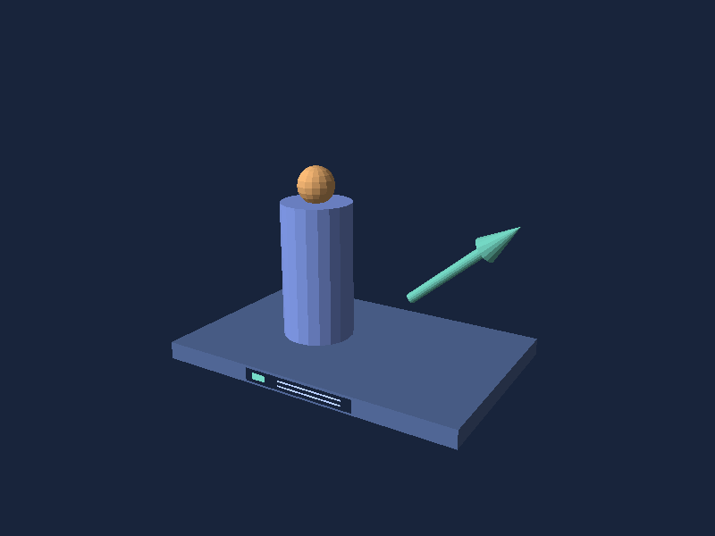

# 3D software renderer for .NET MAUI

Simple3D draws opaque, depth-aware illustrations on iOS, Android, and Mac Catalyst. Build scenes from boxes, spheres, cylinders, pyramids, lines, arrows, or your own indexed mesh. Add textures, OBJ geometry, vertex colors and flat or smooth directional lighting. Place a `SceneView` in a MAUI page, then drag to orbit, pinch to zoom, and tap to pick the visible shape.

Start with [Getting started](getting-started.md), then learn [scenes and cameras](scenes-and-cameras.md), [meshes and groups](meshes-and-groups.md), [materials, lighting and OBJ import](materials-and-import.md), and [interaction and picking](interaction-and-picking.md). The [five examples](examples.md) share their scene factories with the interactive app: orbit Equipment's textured controller and use Surface's shading and light controls to compare the rendering options. The [API reference](xref:Simple3D.Core) covers both library projects.

Read [Architecture and rendering pipeline](architecture.md) for package boundaries, depth rendering, picking and buffer ownership.

Use the library under the [MIT license](https://github.com/mariusmuntean/Simple3D-Maui/blob/main/LICENSE). Source and the gallery app are in the [repository](https://github.com/mariusmuntean/Simple3D-Maui).
