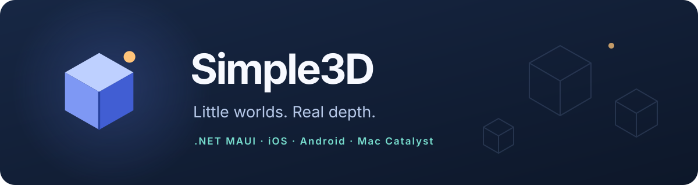
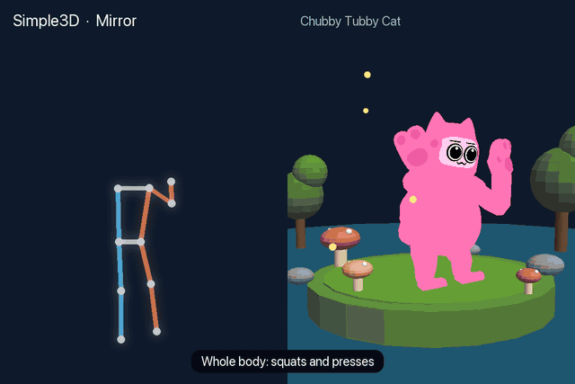
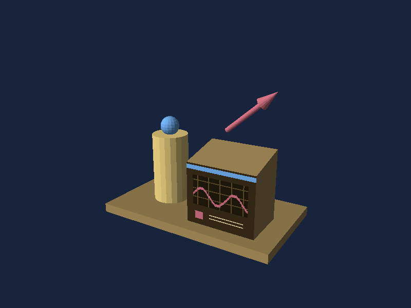

# 3D scene renderer for .NET MAUI

Simple3D draws opaque, depth-aware scenes on iOS, Android, and Mac Catalyst, natively on Metal or OpenGL ES 3 with a software fallback. Build scenes from boxes, spheres, cylinders, pyramids, lines, arrows, your own indexed mesh, or rigged glTF/VRM characters. Add textures, OBJ geometry, vertex colors and flat or smooth directional lighting; pose skeletons and drive facial expressions; animate at the display's full refresh rate. Place a `SceneView` in a MAUI page, then drag to orbit, pinch to zoom, and tap to pick the visible shape.

The gallery's [Mirror scene](examples.md#mirror) shows what this adds up to: the camera tracks a person's body and face on the device, and a skinned VRM character copies a talking, smiling face, arms and torso, and whole-body squats. The GIF shows real people from public-domain NASA/JSC and CDC videos, who do not endorse this project.

Start with [Getting started](getting-started.md), then learn [scenes and cameras](scenes-and-cameras.md), [meshes and groups](meshes-and-groups.md), [materials, lighting and OBJ import](materials-and-import.md), [skinned characters and glTF](skinned-characters.md), and [interaction and picking](interaction-and-picking.md). The [five examples](examples.md) share their scene factories with the interactive app: orbit Equipment's textured controller and use Surface's shading and light controls to compare the rendering options. The [API reference](xref:Simple3D.Core) covers both library projects.

Read [Architecture and rendering pipeline](architecture.md) for package boundaries, depth rendering, picking and buffer ownership.

Use the library under the [MIT license](https://github.com/mariusmuntean/Simple3D-Maui/blob/main/LICENSE). Source and the gallery app are in the [repository](https://github.com/mariusmuntean/Simple3D-Maui).

[Choose native GPU or software rendering](hardware-rendering.md).
